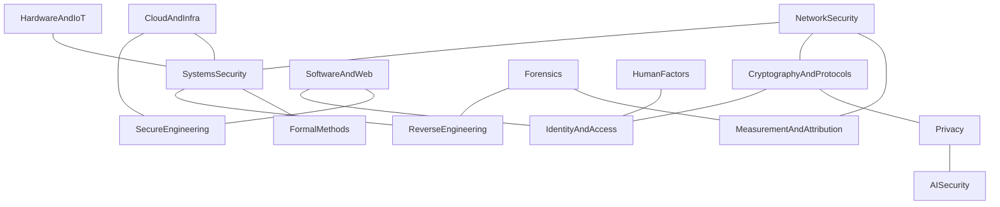

# 資安研究地景

[從這裡開始](00-START-HERE.md) · [地圖](README.md) · [共同基礎](02-CORE-FOUNDATIONS.md)

資安研究問的是：一個系統在哪些假設下保護哪些性質，這些假設何時失效，以及能否用更清楚的模型、更小的攻擊面或可測量的防禦把性質保住。性質通常包括機密性、完整性、可用性、可歸責性與隱私，但每個專長保護的對象不同。

## 研究者實際在保護什麼

| 專長 | 主要對象 | 典型證據 |
|---|---|---|
| [網路安全](modules/01-network-security.md) | 封包、路徑、名稱、傳輸協定 | 擷取、量測、規格與偵測器行為 |
| [系統安全](modules/02-operating-system-and-systems-security.md) | 行程隔離、記憶體、權限邊界 | 核心介面、攻擊面、隔離實驗 |
| [軟體與 Web](modules/03-software-and-web-security.md) | 應用程式的信任邊界 | 程式、威脅模型、授權測試 |
| [密碼與協定](modules/04-cryptography-and-protocol-security.md) | 定義下的保密、完整性、鑑別 | 證明、假設、實作偏差 |
| [鑑識與事件回應](modules/05-digital-forensics-and-incident-response.md) | 事件的時間線與證據可靠性 | 映像、日誌、保管鏈 |
| [逆向與惡意程式](modules/06-malware-analysis-and-reverse-engineering.md) | 程式實際行為 | 反組譯、受控動態觀察 |
| [雲端與基礎設施](modules/07-cloud-container-and-infrastructure-security.md) | 控制平面、身分與隔離 | 設定、稽核日誌、基準 |
| [硬體與嵌入式](modules/08-hardware-embedded-and-iot-security.md) | 硬體信任根與裝置生命週期 | 韌體、介面、模擬 |
| [身分與存取](modules/09-identity-authentication-and-access-control.md) | 誰可以做什麼 | 模型、協定、失敗案例 |
| [AI 安全](modules/10-ai-and-machine-learning-security.md) | 模型、資料與 AI 系統行為 | 受控評估、威脅框架 |
| [隱私](modules/11-privacy-and-data-security.md) | 個人資料與推論洩漏 | 定義、威脅模型、合成資料 |
| [形式方法](modules/12-formal-methods-and-program-analysis.md) | 規格與程式是否滿足性質 | 反例、證明、靜態分析 |
| [情資、歸因、量測](modules/13-threat-intelligence-attribution-and-measurement.md) | 活動、基礎設施與不確定性 | 公開資料、量測、信心評估 |
| [安全工程與供應鏈](modules/14-secure-software-engineering-and-supply-chain.md) | 軟體如何被建造與交付 | 建置、來源、依賴 |
| [人因與經濟學](modules/15-human-factors-and-security-economics.md) | 人的決策與誘因 | 實驗、政策、風險溝通 |

## 它們如何相鄰

相鄰不表示必須先精通鄰居。學 TCP 時，IP 先到 L1，BGP 保持 L0。學 DDoS 偵測時，統計到「能說明指標與基線」，假設檢定可以等到你要比較兩種偵測器。

## 四類工作不要混成一張清單

| 類型 | 問的問題 | 主要出現在 |
|---|---|---|
| 概念 | 它解決什麼問題、架構是什麼 | 每個模組的 Stage 0–1 |
| 數學 | 哪種定義或推論在支撐主張 | [數學](foundations/mathematics.md)、密碼、隱私、形式方法、量測 |
| 程式與實作 | 你能否觀察或做出一個小系統 | [程式](foundations/programming.md) 與各模組實作節 |
| 研究與實驗 | 主張是否被證據支持、限制是什麼 | [研究法](04-RESEARCH-METHODOLOGY.md) 與 Stage 4 |

## 規格、實作、架構、安全研究

這四件事常被當成同一門課：

- 規格說明允許的行為與必須滿足的規則，例如 RFC。
- 實作是某一份程式在某一平台上的選擇，可能偏離規格。
- 架構是元件如何分工，例如客戶端—伺服器、自治系統。
- 安全研究問的是：規格假設了什麼對手、實作是否守住這些假設、架構把信任放在哪裡。

只讀規格不會自動得到安全結論。只會用工具也不會。研究要同時指出你觀察的是哪一層。

## 這個地圖故意不展開的東西

攻擊操作、漏洞利用步驟、惡意程式技術細節、各雲端產品的完整目錄，都不在地圖層。它們若與防禦研究有關，會在對應模組以威脅模型出現，並標成可延後。

---

[從這裡開始](00-START-HERE.md) · [共同基礎](02-CORE-FOUNDATIONS.md) · [興趣評估](05-INTEREST-ASSESSMENT.md)
