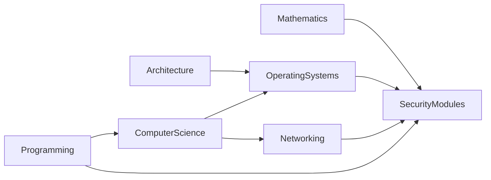

# 共同基礎

[領域地圖](01-CYBERSECURITY-MAP.md) · [地圖](README.md) · [學習法](03-LEARNING-METHODOLOGY.md)

共同基礎的目的，是讓你能開始抽樣多個專長。它不是另一條必須先走完的無限課程。

## 現在、稍後、真正用到再學

| 基礎 | 現在 | 稍後 | 用到再學 |
|---|---|---|---|
| [程式](foundations/programming.md) | Python 讀寫檔案與封包；C/C++ 指標與記憶體到能讀系統程式 | 並行與網路程式到能寫小客戶端 | Rust、Go、核心模組開發 |
| [計算機科學](foundations/computer-science.md) | 複雜度、位元表示、行程與執行緒的 L1 | 分散式系統的故障模型 L0–L1 | 資料庫內部、特定架構風格 |
| [數學](foundations/mathematics.md) | 邏輯、集合、基礎機率與統計 | 圖論到能讀拓撲；線性代數看你是否走向 AI 或密碼 | 數論、資訊理論、最佳化、形式邏輯的深入 |
| [計算機結構](foundations/computer-architecture.md) | 暫存器、記憶體階層、特權級 L1 | x86-64 與 ARM 的呼叫慣例 L1 | 微架構側信道 |
| [作業系統](foundations/operating-systems.md) | 行程、虛擬記憶體、系統呼叫、權限、使用者態與核心態 | 排程與同步 L1；Linux 與 Windows 架構對照 L0–L1 | 核心子系統原始碼 |
| [計算機網路](foundations/computer-networking.md) | 封裝、IP、UDP、TCP、DNS、HTTP、TLS 的指定深度 | 路由、自治系統、BGP 保持 L0，除非主修路由 | 擁塞控制研究、網路量測方法學的進階 |
| [軟體工程](foundations/software-engineering.md) | Git、測試、讀陌生程式、實驗可重現 | 程式架構與介面設計 | 大型建置系統與供應鏈，見模組 14 |

## 依賴關係

箭頭表示「有助於」，不是「必須先精通來源才能碰目標」。模組裡的先修表才是該主題的 REQUIRED。

## 四個常見的過度準備

- 為了讀 TCP，先把所有路由協定學完。路由表的 L0 就夠說明「下一跳是別人決定的」。
- 為了做封包觀察，先學完核心網路堆疊原始碼。使用者態擷取與 RFC 就夠開始。
- 為了碰密碼協定，先證明所有數論定理。模組 04 會標出最小深度。
- 為了選專長，先把十五個模組的工具都裝好。Phase C 每個候選只做一個觀察練習。

## 完成共同基礎的可測量標準

你可以用自己的話完成下列說明，並指出每項你還沒讀的部分：

1. 一個 TCP 連線在你自己的程式之間如何建立，以及你刻意不解釋的擁塞控制細節。
2. 行程、虛擬位址與系統呼叫各自保護什麼。
3. 一個機率估計需要樣本與基線，單次觀察不是分佈。
4. C 的指標錯誤與 Python 腳本在研究裡各解決什麼問題。
5. 規格、某一份實作、與你在虛擬機裡看到的封包，三者可以不一致。

做到這裡就可以進入 Phase C。缺口記在 [進度](PROGRESS-TRACKER.md)，不要停下來補完全部選修。

---

[程式](foundations/programming.md) · [網路](foundations/computer-networking.md) · [數學](foundations/mathematics.md)
