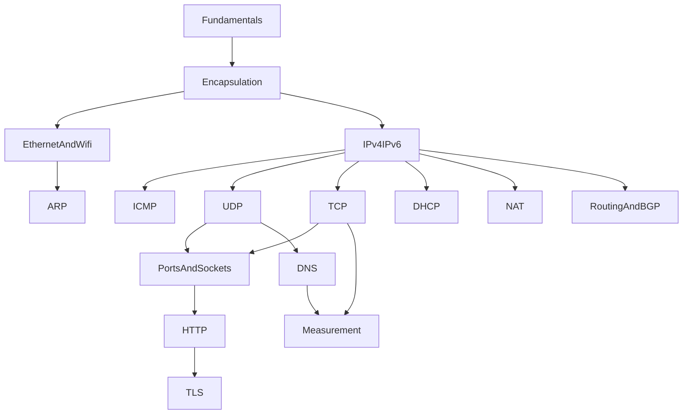

# 計算機網路

[作業系統](operating-systems.md) · [共同基礎](../02-CORE-FOUNDATIONS.md) · [軟體工程](software-engineering.md)

這是探索網路安全之前的基礎，不是協定百科。每個主題都標出：它解決的問題、所在層次、依賴、先讀什麼、現在要多深、哪些安全主題會用到。

學習類型以概念為主。寫 socket 屬於 [程式](programming.md)。讀 RFC 屬於研究技能，範圍控制見 [學習法](../03-LEARNING-METHODOLOGY.md)。

## 四件事不要混在一起

- 規格：RFC 或其他標準寫的規則。
- 實作：Linux 網路堆疊、某個函式庫或設備的選擇。
- 架構：主機、路由器、名稱系統、自治系統如何分工。
- 安全研究：這些規則把信任放在哪裡、觀察與規格差在哪裡、防禦能檢查什麼。見 [模組 01](../modules/01-network-security.md)。

## 依賴

讀 TCP 時：IP 到 L1，TCP 到 L2，BGP 保持 L0。進階路由研究整段延後。

## 主題

### 1. 通訊基本問題

解決什麼：把位元組從一個程式送到另一個程式，儘管線路不可靠、主機很多。

層次：問題陳述，不是單一協定。

依賴：沒有。

先讀：無。

現在深度：L1。REQUIRED。

安全主題：所有網路研究。你要先能描述正常傳遞，才能談偏離。

### 2. 封裝與封包傳遞

解決什麼：每一層加上自己的標頭，讓下一層不用懂上一層的內容。

層次：跨層概念。

依賴：基本問題。

現在深度：L1。REQUIRED。

安全主題：解析器信任長度欄位、隧道把內層隱藏起來。隧道細節 ON-DEMAND。

### 3. 乙太網路與 Wi-Fi 概念

解決什麼：同一段區域網路或無線網路上的影格傳遞。

層次：鏈路。

依賴：封裝。

現在深度：L0。RECOMMENDED。知道影格有來源與目的位址、無線有存取控制即可。

安全主題：區域網路竊聽假設、偽造鏈路位址。無線密碼學不在這一層展開。

可延後：CSMA/CA 參數、個別實體層編碼。

### 4. MAC 位址

解決什麼：鏈路層識別介面。

現在深度：L1。REQUIRED 到「它不是 IP，也不是人」。

安全主題：在區域網路可被觀察與偽造；不能當身份。

### 5. ARP

解決什麼：在區域網路把 IPv4 位址對到 MAC。

依賴：MAC 與 IPv4 位址的 L0。

現在深度：L1。RECOMMENDED。知道它是區域網路的快取，預設不驗證對應關係。

安全主題：區域網路的位址欺騙是 L0 威脅模型。不要在未授權網路做實驗。

### 6. IP 位址與子網路

解決什麼：階層式定位，讓轉送不必記住每台主機。

現在深度：L1。REQUIRED。你要會算一個你自己實驗網路的前綴。

安全主題：位址是定位，不是身份。私有位址與公有位址不同。

### 7. IPv4 與 IPv6

解決什麼：跨網路轉送資料包。

依賴：位址與封裝。

現在深度：IPv4 L1 REQUIRED；IPv6 L0 RECOMMENDED，直到你的環境主要用它。

要懂的欄位：來源、目的、長度、跳數限制。其餘欄位 ON-DEMAND。

安全主題：來源位址可由發送端填寫，轉送設備不一定核對。這是偽造來源的前提，也是 DDoS 與回溯研究的前提。

### 8. ICMP

解決什麼：回報傳遞問題與提供簡單查詢。

依賴：IP。

現在深度：L0。RECOMMENDED。知道「主機不可達」與時間超過是訊號，不是攻擊本身。

安全主題：這些訊息可以被偽造或用來推測路徑。路徑推測的研究在模組 01 與 13，不在這裡做對公網的探測。

### 9. UDP

解決什麼：把資料包交給某個埠，不保證送達、順序或不重複。

依賴：IP。

現在深度：L1。REQUIRED。

安全主題：DNS、部分 VPN 與許多放大攻擊的傳輸層。放大攻擊只作為威脅模型：小請求引發大回應，且若來源可偽造，回應會打到別人。不提供執行步驟。

### 10. TCP

解決什麼：在不可靠的 IP 上提供位元組串流、順序、重送與流量控制。

依賴：IP L1。擁塞控制是 TCP 的一部分，但研究級內容可分開。

現在深度：L2。REQUIRED，若你的目標是網路安全或自己寫傳輸程式。

要懂：埠、序號、三次交握、結束、重送、接收窗。你要能在自己的擷取裡指出這些。

可延後到 L0：擁塞控制演算法的演進、各作業系統參數。除非你的問題是擁塞或濫用擁塞訊號。

安全主題：序號與連線狀態是欺騙與重置議題的背景；中間人與路徑上的攻擊者能力不同。TLS 才提供密碼學保護，TCP 本身不提供。

規格入口：RFC 9293（TCP）在你做到 L2 時讀狀態機與安全考量，不要從第一頁線性讀完。

### 11. 埠與 socket

解決什麼：同一台主機上的不同程式共用 IP。

依賴：UDP 或 TCP。

現在深度：L1。REQUIRED。

安全主題：埠不是權限。綁定低編號埠在 Unix 上與權限有關，那是作業系統政策。

### 12. DNS

解決什麼：把名稱解析成位址或其他記錄。

依賴：UDP 或 TCP、自己的記錄格式。

現在深度：L1。REQUIRED。知道遞迴解析、權威伺服器與快取的差別。

可延後：DNSSEC 的密碼細節到 [模組 01](../modules/01-network-security.md) 與 [模組 04](../modules/04-cryptography-and-protocol-security.md)，先 L0。

安全主題：解析結果會被快取、路徑上可能被改、名稱不是營運者身份。

### 13. DHCP

解決什麼：主機取得位址與預設閘道。

依賴：區域網路與 IP。

現在深度：L0。OPTIONAL，直到你在自己的實驗網路發位址。

安全主題：在區域網路，回應者可以被冒充。這是 L0。

### 14. HTTP 與 HTTPS

解決什麼：應用程式請求與回應。HTTPS 是 HTTP 跑在 TLS 上。

依賴：TCP 或 QUIC 的 L0、埠。

現在深度：HTTP L1 REQUIRED；方法、標頭、狀態碼能在自己的流量裡認出來。

可延後：HTTP/2 與 HTTP/3 的影格細節，除非你在看加密流量的形狀或新的傳輸。QUIC 先 L0：它把傳輸與加密綁得更緊，舊的「看 TCP 埠就知道」更弱。

安全主題：Cookie、來源與標頭是 Web 安全的輸入，見 [模組 03](../modules/03-software-and-web-security.md)。

### 15. TLS

解決什麼：為應用資料提供機密性、完整性與伺服器鑑別，條件是憑證驗證真的有做。

依賴：有一個位元組串流或 QUIC；密碼概念 L0。

現在深度：L1。REQUIRED 對網路與 Web。你要能說明交握在認證誰、加密從何時開始、憑證鏈失敗會怎樣。

可延後：記錄層格式、所有擴充、密碼套件清單。那是 L2，在你分析互操作性或實作缺陷時再生效。

規格：RFC 8446 是 TLS 1.3。先讀簡介與安全考量。

### 16. NAT

解決什麼：許多主機共用較少的公有位址，並改寫封包。

依賴：IP、傳輸埠。

現在深度：L1。RECOMMENDED。

安全主題：外面看到的來源位址可能是轉譯設備，不是產生封包的主機。這直接影響歸因，見 [詞彙](../GLOSSARY.md)。

### 17. 路由與路由表

解決什麼：每個轉送設備依表決定下一跳，沒有全網同時一致的單一路徑視圖。

依賴：IP。

現在深度：L1。REQUIRED 到這個句子。路由協定全家只取一個例子即可。

安全主題：路徑是互相宣告出來的，不是地圖上的事實。

### 18. 自治系統

解決什麼：用一個編號代表一組對外呈現單一路由政策的網路。

依賴：路由 L0。

現在深度：L0。RECOMMENDED。

安全主題：自治系統是基礎設施層級，不是公司部門，更不是人。

### 19. BGP

解決什麼：自治系統之間交換可達性與政策。

依賴：自治系統 L0、IP 前綴 L1。

現在深度：L0。OPTIONAL，除非你主修網際網路路由安全。

你只需知道：路徑是宣告的、政策會隱藏資訊、錯誤或惡意宣告會改變可達性。BGP 安全機制（例如 RPKI 的存在）先記名字，細節在路由安全成為題目時再讀。

可延後：屬性全集、政策設定、任何對真實網際網路的實驗。

### 20. 量測與流量分析

解決什麼：用可說明的方法觀察遺失、延遲、路徑或流量組成。

依賴：你要量的那一個協定的正常行為。

現在深度：L1。RECOMMENDED；若你走向 DDoS 偵測或模組 13，升為 REQUIRED。

要會的：被動觀察與主動探測不同；主動探測容易影響他人，預設只對自己的實驗環境做。擷取有取樣與時鐘偏差。

## 其他常用概念

| 概念 | 深度 | 重要性 | 說明 |
|---|---|---|---|
| 防火牆與封包過濾 | L1 | RECOMMENDED | 依標頭規則允許或拒絕。狀態型防火牆會記連線。它不是偵測研究的全部 |
| 客戶端—伺服器 | L1 | REQUIRED | 誰發起請求。對等架構另當 OPTIONAL |
| 網路拓撲 | L0 | OPTIONAL | 圖論裡的路徑與連通就夠；見 [數學](mathematics.md) |
| 擁塞控制 | L0 | ON-DEMAND | 知道 TCP 會因遺失而放慢。演算法比較是獨立研究 |

## 練習

只在你自己的機器與虛擬機之間：

1. 用 Wireshark 擷取一次到 `127.0.0.1` 或你的虛擬機的 HTTP 或 TCP 連線。標出乙太網路或迴路、IP、TCP 與應用資料各從哪一層開始。文件見 [Wireshark](https://www.wireshark.org/docs/)。
2. 對一個你有權查詢的名稱做 DNS 查詢，寫下回應類型與你還不能解釋的欄位。
3. 列出這次擷取沒有告訴你的三件事：例如路徑上的路由器、對方是誰、內容是否完整。

## 自測

你能選擇「我正在學 TCP」並說出：IP 停在 L1、BGP 停在 L0、擁塞控制演算法還沒讀。你也能指出下一個安全問題該去 [模組 01](../modules/01-network-security.md)，而不是再收集十個協定。

## 教材

[Kurose and Ross 第 9 版](https://gaia.cs.umass.edu/kurose_ross/) 用來建立分層，付費，作者站有輔助材料。[CS144](https://web.stanford.edu/class/cs144/) 在你決定實作傳輸層時再使用。[RFC Editor](https://www.rfc-editor.org/) 按主題單篇閱讀。細節與檢閱日見 [資源索引](../RESOURCE-INDEX.md)。

---

[模組 01](../modules/01-network-security.md) · [作業系統](operating-systems.md) · [資源索引](../RESOURCE-INDEX.md)
